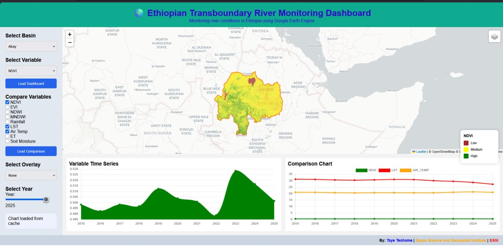

# Ethiopian Transboundary River Monitoring Dashboard

Near-real-time **satellite monitoring** of Ethiopia's six transboundary river basins, with
temporal analysis, river-corridor monitoring, Green Legacy vegetation monitoring and a clearly
separated integration point for hydrological gauge data.

Built with FastAPI, Google Earth Engine, Leaflet and Chart.js ·
Space Science and Geospatial Institute (SSGI)



---

## What it does

* **Executive overview** — all six basins, NDVI/NDWI/MNDWI, observation counts, valid-pixel
  coverage, latest acquisition date and an explicit data status per basin.
* **Interactive GIS map** — real basin and river-corridor boundaries from the project's own
  shapefiles, Sentinel-2 indicator layers, Green Legacy planting sites, legend with numeric
  stops, scale bar, coordinates, full-screen, opacity control and three basemaps.
* **Time series** — annual or monthly means per indicator, with gaps shown as gaps.
* **Comparison and change detection** — basin-to-basin comparison, and baseline-vs-comparison
  difference maps with comparability checks and honest percentage-change handling.
* **River-corridor monitoring** — 2,000 m buffered river network vs whole basin, computed with
  identical masks and scales.
* **Green Legacy** — 21,429 planting sites, areas computed from geometry, counts by region,
  with the layer's data defects reported rather than hidden.
* **Hydrology** — a documented integration point. No gauge feed is connected, so the dashboard
  says so instead of inventing readings.
* **Exports** — statistics/time-series/change CSVs with full provenance, chart and map PNG, and a
  printable summary for PDF.

## What it does not claim

Satellite indices are **not** river stage or discharge. Sentinel-2's revisit time, cloud cover
and processing delay make this near-real-time monitoring of *indicators*, not continuous
hydrological monitoring. Missing data is shown as missing: no value is interpolated, back-filled
or replaced with zero, and no observation is simulated.

---

## Quick start

```bash
python3 -m venv .venv && source .venv/bin/activate
pip install -r requirements.txt
cp .env.example .env                     # then edit
uvicorn main:app --host 0.0.0.0 --port 8000
```

Open <http://localhost:8000> for the dashboard and <http://localhost:8000/api/docs> for the API.

The application **starts without Earth Engine credentials**: basin geometry, Green Legacy data,
the map and the API documentation all work, and satellite products report
`earth_engine_unavailable` instead of failing or inventing values.

To enable satellite products, authenticate once (never inside the server):

```bash
python -c "import ee; ee.Authenticate()"
```

Full instructions, environment variables and deployment options:
[`docs/DEPLOYMENT.md`](docs/DEPLOYMENT.md).

---

## Monitored basins

| Basin | Area (km²) | River corridor (km²) | Source CRS |
| --- | --- | --- | --- |
| Abay (Blue Nile) | 199,975.5 | 19,075.1 | EPSG:32637 |
| Baro-Akobo | 63,011.9 | 19,326.3 | **EPSG:4326** (buffer EPSG:32636) |
| Genale-Dawa | 144,233.6 | 5,363.5 | EPSG:32637 |
| Omo-Gibe | 79,487.1 | 4,694.5 | EPSG:32637 |
| Tekeze | 61,703.5 | 16,335.2 | EPSG:32637 |
| Wabe-Shebelle | 193,635.8 | 8,604.9 | EPSG:32637 |

Areas are computed geometrically in ESRI:102022 (Africa Albers Equal Area Conic); river
corridors are the digitised river network buffered by 2,000 m. The basin `SQKM` attributes
disagree with the geometry (Abay: 15,123 vs 199,975 km²) and are not used — the disagreement is
published as a warning by `/api/basins`.

---

## Indicators

| Indicator | Dataset | Bands / field | Scale | Units |
| --- | --- | --- | --- | --- |
| NDVI | Sentinel-2 SR Harmonized | B8, B4 | 10 m | −1…1 |
| EVI | Sentinel-2 SR Harmonized | B8, B4, B2 | 10 m | −1…1 |
| NDWI | Sentinel-2 SR Harmonized | B3, B8 | 10 m | −1…1 |
| MNDWI | Sentinel-2 SR Harmonized | B3, B11 | 10 m | −1…1 |
| Rainfall | CHIRPS v2.0 daily | precipitation | ~5.5 km | mm/period |
| Land surface temperature | MOD11A2 | LST_Day_1km | 1 km | °C |
| Air temperature | ERA5-Land daily | temperature_2m | ~9 km | °C |
| Evapotranspiration | MOD16A2GF | ET | 500 m | mm/8-day |
| Surface soil moisture | SMAP L4 | sm_surface | ~9 km | m³/m³ |

Sentinel-2 scenes are masked with the Scene Classification Layer (cloud, cloud shadow, cirrus,
snow, defective) **and** the QA60 bits, then composited per-pixel with the median. Every product
reports its observation count, valid-pixel coverage, latest acquisition date and mask method.

Equations, masks, compositing, thresholds and limitations:
[`docs/SCIENTIFIC_METHODS.md`](docs/SCIENTIFIC_METHODS.md).

---

## Project layout

```
app/                  application package
  config.py           settings (env) + basin registry
  indicators.py       bands, equations, scales, units, palettes — single source of truth
  geometry.py         shapefiles → validated GeoJSON, equal-area areas, caches
  ee_client.py        lazy Earth Engine init, timeouts, retries, availability
  satellite.py        masking, indices, compositing, ancillary products
  statistics.py       zonal statistics with valid-pixel accounting
  timeseries.py       annual/monthly series in one round trip
  tiles.py            tile URLs, difference products, comparability checks
  service.py          orchestration and caching
  exports.py          CSV builders with provenance
  report.py           printable summary (browser → PDF)
  hydrology.py        gauge integration contract
  demo.py             labelled demonstration data (off by default)
  main.py             FastAPI routes
static/               dashboard front end (index.html, styles.css, app.js, vendor/)
shapefiles/           project vector data (unmodified)
tests/                99 tests + numerical Earth Engine fake + front-end smoke test
scripts/              cache warming
docs/                 audit, methods, API, deployment, testing, change log
legacy/               original main.py / gee_service.py / index.html (rollback)
```

---

## Tests

```bash
pip install -r requirements-dev.txt
python -m pytest tests -q          # 99 tests
node tests/frontend_smoke.mjs      # front end against a running server
```

Processing tests run the real satellite/statistics code against a numerical Earth Engine
stand-in, so band selection, masking, scaling and empty-data handling are verified without
credentials. Results, coverage and blocked items: [`docs/TESTING.md`](docs/TESTING.md).

---

## Documentation

| Document | Contents |
| --- | --- |
| [`docs/AUDIT.md`](docs/AUDIT.md) | repository audit: findings, severity, evidence, data inventory |
| [`docs/SCIENTIFIC_METHODS.md`](docs/SCIENTIFIC_METHODS.md) | data sources, equations, masks, compositing, limitations |
| [`docs/API.md`](docs/API.md) | endpoint reference, error contract, payloads |
| [`docs/DEPLOYMENT.md`](docs/DEPLOYMENT.md) | installation, Earth Engine auth, production, Docker, systemd |
| [`docs/TESTING.md`](docs/TESTING.md) | executed tests, results, blocked items |
| [`docs/CHANGELOG.md`](docs/CHANGELOG.md) | files changed, rationale, compatibility, rollback |

---

## Data integrity policy

1. No fabricated observations, gauge readings or stations — ever.
2. Missing data is `null` with a status, never `0` or an interpolated value.
3. Every product exposes dataset, bands, equation, scale, mask, compositing, observation count,
   pixel coverage, acquisition time and processing time.
4. Demonstration data exists for interface development only, is off by default
   (`ALLOW_DEMO_MODE=false`), and is labelled in every payload and in the UI banner.
5. Known defects in the source data (CRS mismatch, `Area_Ha` in m², unusable `Species`/`Planted`,
   basin area attributes) are worked around **and reported**, not silently corrected.
6. Satellite indices are never presented as hydrological measurements.
